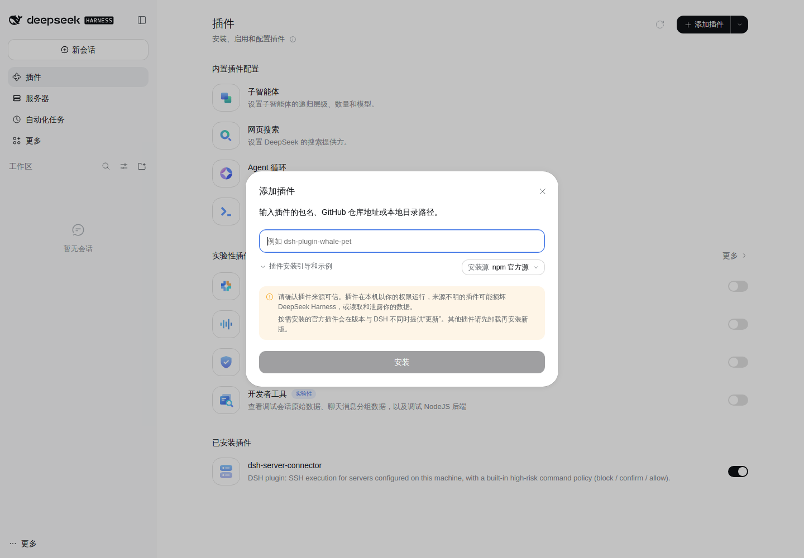
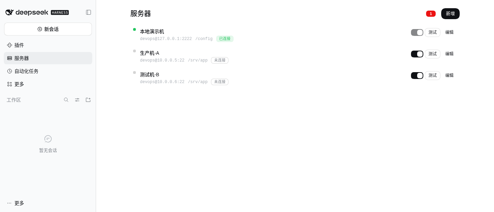
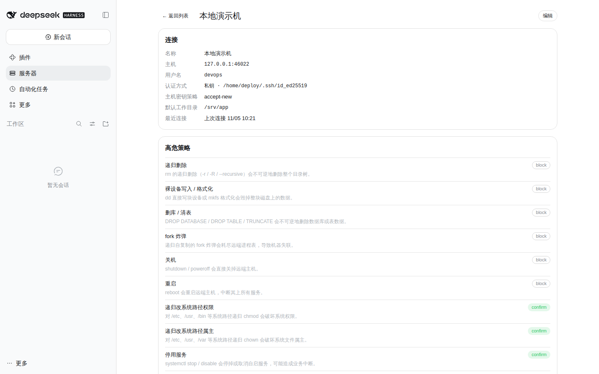
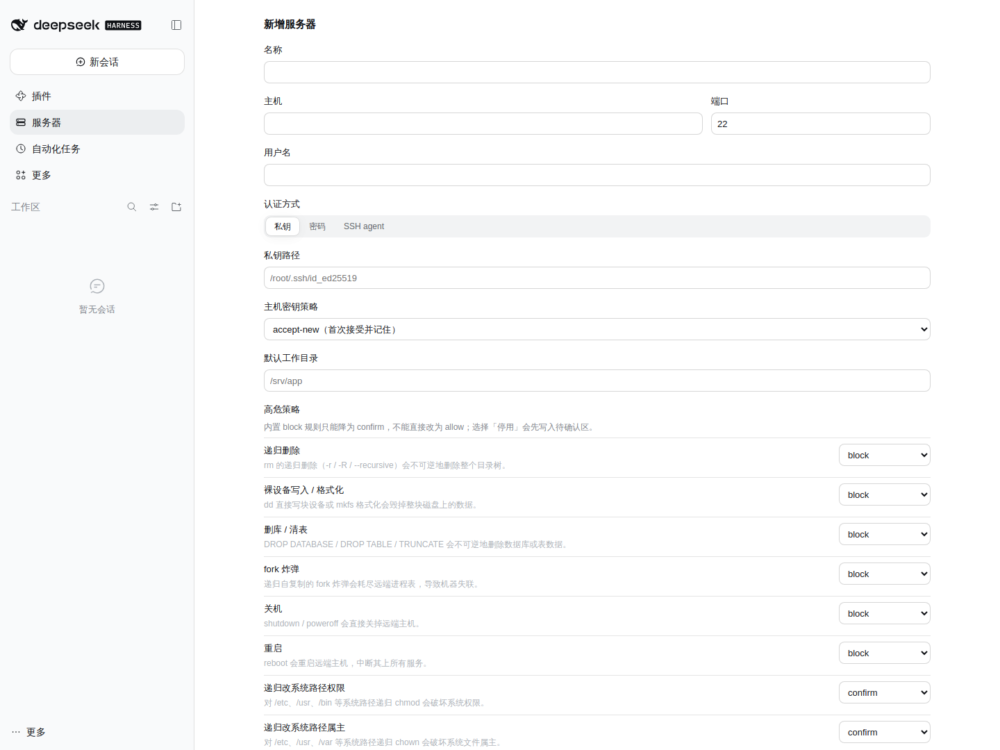
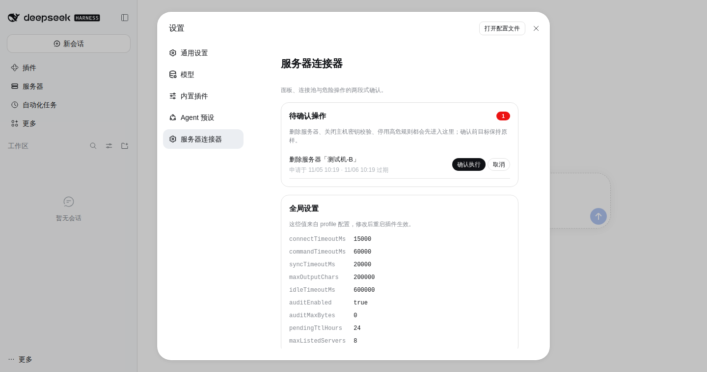

# dsh-server-connector

DSH（DeepSeek Harness）插件：在本机配置好可运维的 SSH 服务器后，让 Harness 里的 agent 用
`srv_*` 工具直接在那些机器上执行命令；内置高危命令策略、逐条审批、执行审计与两段式危险操作确认。

本 README 侧重**怎么用**：安装、添加服务器、让 agent 执行、看懂审批与审计、调整配置。
设计细节（数据模型、实现取舍）见 [`docs/design.md`](./docs/design.md)。

- 运行环境：DSH `>=0.1.0-rc.6 <0.3.0`，Node `^22.19.0 || >=24.0.0`
- 插件形态：Host 半（`srv_*` 工具、连接池、策略、审计）+ Client 半（侧边栏「服务器」面板与设置页）
- 数据目录：`$DSH_HOME/server-connector/`（`$DSH_HOME` 默认 `~/.dsh`）

---

## 目录

- [它能做什么](#它能做什么)
- [安装](#安装)
- [五分钟上手](#五分钟上手)
- [服务器面板](#服务器面板)
- [Agent 工具](#agent-工具)
- [高危命令策略](#高危命令策略)
  - [自定义规则（每台服务器独立）](#自定义规则每台服务器独立)
- [审批与两段式确认](#审批与两段式确认)
- [输出与后台任务](#输出与后台任务)
- [审计](#审计)
- [配置](#配置)
- [主机密钥与凭据](#主机密钥与凭据)
- [排错](#排错)
- [已知限制](#已知限制)
- [开发](#开发)

---

## 它能做什么

| 你会用它做 | 怎么发生 |
|---|---|
| 让 agent 在服务器上查状态、看日志、跑脚本 | 模型调用 `srv_exec(server, command)`，插件经连接池执行，返回 exitCode、stdout、stderr |
| 避免 agent 手滑执行破坏性命令 | 20 条内置高危规则先判定：`block` 直接拒绝，`confirm` 弹审批框，`allow` 直接执行 |
| 事后追查谁执行了什么 | 每次 `srv_exec` 写一行 JSON 到 `audit.log`，面板里也能看到最近 20 条 |
| 长命令不阻塞对话 | 超过同步窗口自动转后台 job，模型用 `srv_job_output` 增量读取、`srv_job_kill` 取消 |
| 删服务器、关主机密钥校验这类危险改动先缓一缓 | 先进设置页的「待确认操作」，确认后才真正生效 |

**不做什么**：不做文件上传/SFTP、端口转发、跳板机、Kerberos（见[已知限制](#已知限制)）。
另外，策略是**遏制不是安全边界**——真正的硬边界仍然是远端那个低权限用户与 sudo 白名单。

---

## 安装

四种方式，按推荐顺序排列。**装进哪个 profile 用 `--profile` 指定**，Web 界面即 `web`。

### 方式一：npm（推荐）

```bash
dsh plugin --profile web add dsh-server-connector
```

指定版本：`dsh plugin --profile web add dsh-server-connector@0.1.0`。

国内网络若装不上或版本滞后，让 pnpm 走官方源：

```bash
dsh plugin --profile web add --registry=https://registry.npmjs.org/ dsh-server-connector
```

> npm 有约 24 小时的「新版本冷却期」（防供应链投毒），刚发布的版本可能暂时装不上，属正常。

### 方式二：GitHub Release 的 tarball（离线 / 锁定版本）

从 [Releases](https://github.com/niechao136/dsh-server-connector/releases) 下载
`dsh-server-connector-<version>.tgz`，然后：

```bash
dsh plugin --profile web add ./dsh-server-connector-0.1.0.tgz
```

tarball 是**预构建**的，安装时不会执行任何构建脚本，因此 pnpm 不会要求
`allowBuilds` 授权——适合不想让第三方代码在安装时运行的场景。

校验下载完整性（可选）：

```bash
# 每个 Release 的说明里都附有 SHA-256
sha256sum dsh-server-connector-0.1.0.tgz        # Linux / macOS
certutil -hashfile dsh-server-connector-0.1.0.tgz SHA256   # Windows
```

### 方式三：GitHub 源码

```bash
dsh plugin --profile web add github:niechao136/dsh-server-connector
```

锁到某个提交更稳（后续推送无法悄悄改变实际运行的内容）：

```bash
dsh plugin --profile web add github:niechao136/dsh-server-connector#<sha>
```

本仓库的 `lib/` 是已提交的纯 JS，没有 `prepare` 构建脚本，所以 git 安装后立即可用，
不会被 pnpm ≥10 的构建脚本拦截。

### 方式四：本地 checkout（开发时）

```bash
dsh plugin --profile web add /path/to/dsh-server-connector
```

`dsh plugin add` 会把包加入 profile 依赖，并自动把它追加到 `package.json` 的
`dsh.profile.bundles`：

```json
{
  "dependencies": { "dsh-server-connector": "0.1.0" },
  "dsh": { "profile": { "bundles": ["@deepseek-ai/dsh-base", "@deepseek-ai/dsh-web-app", "dsh-server-connector"] } }
}
```

确认装好了：

```bash
dsh --profile web --dump-config | grep -A2 dsh-server-connector
# - id: dsh-server-connector
#   name: dsh-server-connector
```

卸载：`dsh plugin --profile web remove dsh-server-connector`（会同时取消 bundle 选择）。

### 方式五：Web 界面

1. 左侧栏进入 **插件**；
2. 右上角 **添加插件**；
3. 填入 `dsh-server-connector`（npm 名）、GitHub 地址或本地绝对路径，选择安装源，点 **安装**；
4. 安装完成后在「已安装插件」里确认开关是打开的。



装完若侧边栏没有出现「服务器」，重启一次 `dsh web` 再试。

---

## 版本与分发渠道

同一个版本号在四个渠道同时提供，内容一致：

| 渠道 | 地址 | 适用 |
|---|---|---|
| npm | `dsh-server-connector` | 日常安装，`dsh plugin add` 直接可用 |
| GitHub Release | 附 `.tgz` + SHA-256 | 离线环境、锁定版本、审计 |
| GitHub 源码 | `github:niechao136/dsh-server-connector` | 想跟源码或钉到某个提交 |
| 本地 checkout | 绝对路径 | 开发调试 |

国内镜像（npmmirror）会自动同步 npm 上的发布，通常几分钟内可用；若滞后，按上文
「方式一」加 `--registry=https://registry.npmjs.org/` 直连官方源。

---

## 五分钟上手

以 Web 界面 + 一台真实服务器为例：

1. **打开面板**：左侧栏点 **服务器**（插件注册的入口，见下图）。
2. **新增服务器**：点右上角 **新增**，填名称、主机、端口、用户名，选认证方式。
   - 私钥：填**本机可读**的绝对路径（保存时会检查文件是否存在）；私钥本身带 passphrase 时本插件不支持，请改用一个无口令的部署密钥；
   - 密码：只写不回显，存进 DSH 凭据服务，`servers.json` 里只留引用；
   - SSH agent：目前只写入认证类型，插件尚未把 agent socket 传给 `ssh2`，实际连接会报 `AUTH_FAILED`（见[已知限制](#已知限制)）；需要 agent 认证请先改用私钥。
3. **测试连接**：列表里点 **测试**，看到「已连接」即通（探测的四项目前显示 `unknown`，属已知缺陷，不影响连通性）。想更稳妥，直接让 agent 跑一条命令验证：
   > 在「生产机-A」上执行 `df -h /`，看看根分区还剩多少
4. **之后每次都说清楚机器**：插件**不做会话绑定**，每次调用都显式传 `server`。
   模型看到系统提示里的服务器清单，会自己带上。



---

## 服务器面板

### 列表

每行显示名称、`用户名@主机:端口`、默认工作目录与连接状态：绿点/「已连接」表示连接池里有活连接，
灰点/「未连接」表示还没连或已被空闲回收。有待确认操作时，标题右侧会出现红色计数徽标。

行内操作：**测试**（建立连接并跑一条探测命令）、**编辑**（打开表单）、点名称进入详情。

### 详情

连接字段只读、逐条高危策略的当前取值、最近 20 条审计，以及底部的 **删除**（删除会先进待确认区）。



### 表单字段

| 字段 | 说明 |
|---|---|
| 名称 | 必填、唯一；可以中文 |
| 主机 / 端口 | 端口 1–65535 |
| 用户名 | 远端登录用户 |
| 认证方式 | 私钥 / 密码 / SSH agent |
| 私钥路径 | 仅私钥认证；必须是本机绝对路径且文件存在 |
| 密码 | 仅密码认证；只写不回显，编辑时留空表示保持原密码 |
| 主机密钥策略 | `accept-new`（默认）/ `verify` / `off`；改 `off` 会进待确认区 |
| 默认工作目录 | 执行 `srv_exec` 未传 `cwd` 时的目录，如 `/srv/app` |
| 高危策略 | 每条内置规则一行：`allow` / `confirm` / `block` / `停用`（内置 block 规则只提供 `confirm` / `block`） |

表单里内置 `block` 规则只能降为 `confirm`，**不能直接改成 `allow`**；选「停用」不会立即生效，
而是写入待确认区，确认后该规则才彻底失效。



表单里只保存**偏离默认值**的规则，所以 `servers.json` 里通常 `policy` 是空对象。

---

## Agent 工具

插件注册 6 个工具，都在系统提示里可见；当有服务器时，系统提示还会附上服务器清单：

```text
可运维服务器（调用 srv_exec 时必须传 server）：
- srv-01  生产机-A   devops@10.0.0.5:22   默认目录 /srv/app
- srv-02  测试机-B   devops@10.0.0.6:22   默认目录 /srv/app
高危策略：service-restart=confirm（可用 srv_policy_check 预检）
```

| 工具 | 参数 | 作用 |
|---|---|---|
| `srv_list` | — | 列出服务器：id、名称、主机、默认目录、是否已连接 |
| `srv_connect` | `server` | 建立或复用连接，并探测远端平台、内核、shell、sudo 可用性（探测字段目前为 `unknown`，见[已知限制](#已知限制)） |
| `srv_exec` | `server`, `command`, `cwd?`, `timeoutMs?`, `async?` | 执行命令 |
| `srv_job_output` | `jobId`, `offset?` | 增量读取后台输出，返回下一个偏移量 |
| `srv_job_kill` | `jobId` | 取消运行中的命令 |
| `srv_policy_check` | `server`, `command` | 只判定 `allow` / `confirm` / `block`，**不连接、不执行** |

### `server` 参数怎么写都行

按顺序尝试：精确 `id` → 精确名称（不区分大小写）→ 唯一前缀。
零命中报 `UNKNOWN_SERVER` 并列出全部服务器；多命中报 `AMBIGUOUS_SERVER` 并列出候选——
模型通常能靠错误信息自己纠正，不用你介入。

### 模型实际看到的返回

`df -h /` 的 `srv_exec` 结果：

```text
srv-01 (生产机-A)  exit 0  46 ms
Filesystem      Size  Used Avail Use% Mounted on
/dev/sda1        98G   61G   32G  66% /
```

`srv_policy_check` 的预检结论（`rm -rf` 命中 block）：

```text
BLOCK on srv-01 (生产机-A) — rule rm-recursive (递归删除)
command: rm -rf /srv/app/old
This command will not run: the rule blocks it. Ask the user to change the server policy if it is really needed.
```

同样的命令交给 `srv_exec` 会被直接拒绝，不会连接、不会执行：

```text
POLICY_BLOCKED: command blocked by rule rm-recursive (递归删除) on server 生产机-A (srv-01): rm -rf /srv/app/old Nothing was sent to the server. Ask the user to allow this rule for that server, or rephrase the command.
```

错误消息是单行：`错误码: 发生了什么 下一步怎么做`，模型据此分支处理。

异步命令立刻拿到 job id：

```text
started background job ssh-3f9a1c2b7d4e5f60 on srv-01 (生产机-A)
command: tar czf /tmp/app.tgz /srv/app
Read it with srv_job_output, stop it with srv_job_kill.
```

### 什么时候用 `srv_policy_check`

命令不确定会不会被拦时先预检。它和 `srv_exec` 用的是同一个判定函数，所以结论不会互相打架：

> 先 `srv_policy_check` 看一下，没问题再执行

---

## 高危命令策略

### 内置 20 条规则

| id | 拦截对象 | 默认 |
|---|---|---|
| `rm-recursive` | `rm -r` / `rm -rf` / `rm --recursive`（`git rm -r` 除外） | block |
| `dd-write` | `dd of=/dev/…`、`mkfs` | block |
| `db-drop` | `DROP DATABASE` / `DROP TABLE` / `TRUNCATE`（含通过 psql、mysql 等执行） | block |
| `fork-bomb` | `:(){ :\|:& };:` | block |
| `shutdown` | `shutdown` / `poweroff` | block |
| `reboot` | `reboot` | block |
| `chmod-root` | 对 `/etc`、`/usr` 等系统路径递归 `chmod` | confirm |
| `chown-root` | 对系统路径递归 `chown` | confirm |
| `service-stop` | `systemctl stop` / `disable` | confirm |
| `service-restart` | `systemctl restart`、`docker restart` | confirm |
| `docker-prune` | `docker prune`、`docker rm -f` | confirm |
| `curl-pipe-sh` | `curl … \| sh` | confirm |
| `kill-all` | `kill -9 -1`、`pkill -9` | confirm |
| `passwd-edit` | 写 `/etc/passwd` / `/etc/shadow` | block |
| `crontab-edit` | `crontab -r`、写 `/etc/cron*` | confirm |
| `iptables-flush` | `iptables -F` | confirm |
| `git-force-push` | `git push --force`（`--force-with-lease` 除外） | confirm |
| `history-clear` | `history -c`、清 `~/.bash_history` | confirm |
| `truncate-log` | 截断 `/var/log/*` | confirm |
| `sudoers-edit` | 写 `/etc/sudoers*` | block |

### 判定语义

1. 命令行按 `&&`、`||`、`;`、`|`、换行拆成子命令，**每一段**都过一遍规则；
2. 命中多条取最严：`block > confirm > allow`；
3. 每台服务器可覆盖默认值，但内置 `block` 只能降为 `confirm`，**不能降为 `allow`**；
4. 要彻底放行某条规则，只能在表单里把该规则设为**停用**（写入 `disabledRules`），且这一步走待确认区；
5. 停用后的规则在 `srv_policy_check` 与 `srv_exec` 中同时消失——两者共用同一个判定函数；
6. 没有命中任何规则就是 `allow`。

> **提醒**：正则拦不住 `python -c "import shutil; shutil.rmtree('/')"` 这类变形。
> 请配合远端专用低权限用户与 sudo 白名单使用。

### 自定义规则（每台服务器独立）

内置 20 条不可能覆盖所有人的「危险」。服务器详情页的 **自定义规则** 区块可以给
**单台** 服务器补规则，不必改插件、不必等发版。

在详情页点 **新增规则**，填四项：

| 字段 | 说明 |
|---|---|
| 标签 | 审批理由里显示的名字 |
| 正则 | **JavaScript 正则**（见下方方言说明） |
| 默认档 | 只有 `confirm` / `block`；不允许 `allow`（放行是默认行为，写了没意义） |
| 样例命令 | 每行一条，**至少一条必须命中**，否则保存会被拒绝 |

先点 **试跑** 再点 **保存**。试跑会逐条告诉你「这条命令会不会被拦」，并且
**不写盘**——它和真正执行走的是同一个判定函数，所以结论不会不一致。

几个要点：

- **正则是 JavaScript 方言，不是 POSIX。** 用 `\s`、`\d`、`\b`；`[[:space:]]`
  这类 POSIX 字符类在 JS 里**不生效**（会被当成普通字符）。写错了不会报错，
  只是永远不命中——而「永不命中」会被样例检查挡下来，你在保存时就能看见。
- **规则 id 由服务端生成**（`custom-1`、`custom-2`…），面板不让你填，避免和内置 id 撞车。
- **新建/修改/删除不走待确认区**：它们只会让限制变严。唯一例外是「停用」，
  等同于改 `disabledRules`，仍走两段式确认。
- **每台服务器最多 50 条**；正则最长 512 字符，且拒绝 `(a+)+` 这类嵌套量词（防正则回溯卡死）。

例如给一台跑 Docker 的机器加：

```
标签：删 Docker 卷
正则：docker\s+compose\s+down\s+-v
默认档：confirm
样例：docker compose down -v
```

之后 agent 执行 `docker compose down -v` 时会先弹审批，`srv_policy_check` 也会返回 `confirm`。

---

## 审批与两段式确认

### agent 执行时的三道闸门

```text
srv_exec(command)
  ├─ ① 策略判定：block → 直接返回 POLICY_BLOCKED（不连接）
  │              confirm → ②
  │              allow → ③
  ├─ ② 用户审批：弹确认框，只有「允许一次」才继续；拒绝/取消/无法询问 → POLICY_DENIED_BY_USER
  └─ ③ 执行：连接池 → 执行 → 写审计 → 返回
```

审批走 DSH 原生 `ctx.approval`，确认框里带着命中规则、服务器名和完整命令原文。
会话审批策略为 `never` 时**不会弹框**，直接拒绝并说明原因——这是 DSH 的 fail-closed 行为。

组合里没有审批服务时（如某些无界面部署），`confirm` 一律按「无法确认」处理并拒绝，不会偷偷执行；
没有后台任务服务时，所有命令强制同步执行，`srv_exec` 也不再返回 `jobId`。

### 面板操作的「待确认区」

面板本身不在 turn 内，没法弹审批框，所以三类危险操作改成两段式：
先记入 `pending.json`（目标保持原样），你回到设置页看到完整上下文后再确认。

| 操作 | 请求后立即 | 确认后 |
|---|---|---|
| 删除服务器 | 服务器仍存在、仍可用 | 删除记录、断开连接、清凭据，审计写 `server-deleted` |
| 主机密钥改为 `off` | 仍按原策略校验 | 改为 `off`，审计写 `hostkey-disabled` |
| 停用某条高危规则 | 规则仍生效 | 加入 `disabledRules`，审计写 `rule-disabled` |

每条记录 24 小时后自动过期（`pendingTtlHours`），过期后必须重新申请；过期记录无法确认。



设置页同时只读展示当前生效的全局配置——这些值来自 profile 配置，改完需要重新加载插件。

---

## 输出与后台任务

| 场景 | 行为 |
|---|---|
| 正常结束 | 返回 `exitCode` + stdout + stderr；非 0 时结果带 `code: EXIT_NONZERO` |
| 输出过大 | 每条流（stdout、stderr 各自）超过 `maxOutputChars` 即截断并标记 `TRUNCATED` |
| 超过同步窗口 | 同步等待 `syncTimeoutMs` 后仍在跑，就返回 `jobId`，后续用 `srv_job_output` 增量读 |
| 主动异步 | `srv_exec` 传 `async: true`，立刻返回 `jobId` |
| 超时 | `timeoutMs` 到点由**远端 watchdog 杀掉整个进程组**，返回 `code: TIMEOUT` |
| 取消 | `srv_job_kill` 请求取消；远端进程组同样被清理 |
| 读得比生产慢 | 环形缓冲丢字节时 `srv_job_output` 返回 `lossy: true` 与完整输出的落盘路径 |
| 连接掉线 | 命令未产生输出前掉线会自动重连并重放**一次**；已经有输出则不再重放（避免重复副作用），报 `CONNECT_FAILED` 并说明是执行中掉线 |

`cwd` 的处理：不传就用服务器的默认工作目录；插件在远端拼 `cd '<cwd>' && …`，
不经过本地 shell，所以引号与转义只在远端 shell 语义下生效。

---

## 审计

`auditEnabled` 开启时（默认），每次 `srv_exec` 都写一行 JSON——`allow`、`confirm`、`block` 都写——追加到
`$DSH_HOME/server-connector/audit.log`：

```json
{"ts":"2026-11-05T02:14:51.311Z","sessionId":"demo-session","serverId":"srv-01","serverName":"本地演示机","command":"df -h /","decision":"allow","policyRule":null,"approved":null,"exitCode":0,"durationMs":85,"truncated":false}
{"ts":"2026-11-05T02:14:51.497Z","sessionId":"demo-session","serverId":"srv-01","serverName":"本地演示机","command":"rm -rf /srv/app/old","decision":"block","policyRule":"rm-recursive","approved":null,"exitCode":null}
```

- `confirm` 且审批通过时 `approved: true`，被拒绝时 `approved: false`；
- `block` 记录 `approved` / `exitCode` 为 `null`，表示命令没有离开本机；
- 非执行事件也写一行，用 `event` 字段区分：`server-deleted`、`hostkey-disabled`、`rule-disabled`；
- `auditMaxBytes > 0` 时超过阈值轮转一次，旧内容落到 `audit.log.1`（最多两份）；
- 面板只读尾部若干条；要看全部直接 `tail -f` 或 grep。

审计写入失败只记日志，不会改变命令本身的执行结果。

---

## 配置

配置写在 profile 的 `cordis.patch.yml`（Web 界面里是「打开配置文件」），按插件行 id 覆盖：

```yaml
- id: dsh-server-connector
  config:
    commandTimeoutMs: 90000
    auditEnabled: false
```

| 键 | 默认 | 说明 |
|---|---|---|
| `connectTimeoutMs` | `15000` | SSH 连接超时 |
| `commandTimeoutMs` | `60000` | 单条命令默认超时，工具参数 `timeoutMs` 可覆盖 |
| `syncTimeoutMs` | `20000` | 同步等待窗口，超过就转后台 job |
| `maxOutputChars` | `200000` | stdout、stderr **各自**的输出上限 |
| `idleTimeoutMs` | `600000` | 连接空闲多久后关闭 |
| `auditEnabled` | `true` | 是否写审计（关闭后命令照常执行） |
| `auditMaxBytes` | `0` | `0` 表示不轮转；大于 0 时超限轮转一次 |
| `pendingTtlHours` | `24` | 待确认记录的有效期 |
| `maxListedServers` | `8` | 系统提示里最多列几台服务器，其余折叠成「另有 N 台」 |

所有键都有默认值，空配置也能启动。改完保存后由 profile 重新加载；没有启用 HMR 的环境需要重启 `dsh web`。

### 数据文件

```text
$DSH_HOME/server-connector/
├── servers.json        # 服务器记录（不含明文密钥）
├── known_hosts.json    # 每台服务器的主机指纹
├── pending.json        # 待确认的危险操作
└── audit.log           # 执行审计（JSONL）
```

`servers.json` 里的 `id` 由插件分配（`srv-01`、`srv-02`…），改名不影响调用；
记录结构见设计文档 §3.1。文件是原子替换写入，`srv_list`、`srv_exec`、`srv_connect`、`srv_policy_check` 每次调用都会重新读一遍，
所以手改后**下一次调用就生效**，不必重启（手改不是推荐做法，面板会做校验）。

---

## 主机密钥与凭据

### 主机密钥

| `hostKeyMode` | 首次连接 | 指纹变了 |
|---|---|---|
| `accept-new`（默认） | 接受并记入 `known_hosts.json` | **拒绝连接**，报 `HOST_KEY_UNKNOWN` |
| `verify` | 直接拒绝（未知主机） | 拒绝 |
| `off` | 不校验 | 不校验（不安全，保存需走待确认区） |

指纹变更时错误信息会提示：确认是换过机器后，删除 `known_hosts.json` 里对应条目（或信任新指纹）再重试。

### 凭据

- 密码交给 DSH 凭据服务（`$DSH_HOME/.credentials.yaml`），`servers.json` 只存引用，如 `server-connector:srv-03:password`；
- 面板只显示「已设置 / 未设置」，不会回显明文；接口也不会返回密钥；
- 没有凭据服务时，密码认证会报 `NO_CREDENTIAL`，改用私钥认证即可；
- 私钥认证只记录**路径**，密钥内容由 `ssh2` 自己读，插件不缓存。

---

## 排错

工具错误都以错误码开头，并附一句下一步提示：

| 错误码 | 含义 | 怎么办 |
|---|---|---|
| `CONNECT_FAILED` | 连不上：网络、端口、sshd | 检查主机/端口、远端 sshd 是否在跑、防火墙 |
| `AUTH_FAILED` | 认证失败 | 核对用户名、私钥路径/密码；用 agent 认证的记录目前必然失败，请改用私钥 |
| `HOST_KEY_UNKNOWN` | 主机指纹未知或已变更 | 确认是同一台机器后清理该条指纹或调整 `hostKeyMode` |
| `NO_CREDENTIAL` | 密码服务器没有存密码 | 在面板里补密码，或改用私钥/agent |
| `POLICY_BLOCKED` | 命中 block 规则 | 命令没有离开本机；确需执行请改服务器策略或换写法 |
| `POLICY_DENIED_BY_USER` | 审批被拒绝/取消/无法询问 | 换一种写法，或在会话里把审批策略调成 `ask` |
| `UNKNOWN_SERVER` | 服务器不存在 | 先 `srv_list`；错误里会列出全部可用服务器 |
| `AMBIGUOUS_SERVER` | 前缀匹配到多台 | 用完整 id 或完整名称 |
| `TIMEOUT` | 超时，远端进程组已被杀 | 调大 `timeoutMs`，或改成 `async: true` |
| `EXIT_NONZERO` | 命令执行了但退出码非 0（是结果里的 `code`，不是抛出的错误） | 看 stderr，命令本身的问题 |
| `CONNECT_FAILED`（执行中） | 命令跑到一半连接断开，已产生输出所以不重放 | 重试；频繁出现就检查网络与 sshd 稳定性 |
| `INVALID_ARGUMENT` | 参数不合法 | 修正参数 |

**面板「测试」一直失败**：先确认这台机器能 `ssh 用户名@主机`；私钥认证注意文件权限（`600`）。

**没有「服务器」入口**：确认 bundle 已选中（`--dump-config` 能看到该行），必要时重启 `dsh web`。

---

## 已知限制

- **高危策略不是安全边界**：正则只能拦住已知模式，`base64 -d | sh`、脚本内的破坏性调用都拦不住。请配合远端低权限用户与 sudo 白名单。
- **`srv_connect` 的探测字段目前恒为 `unknown`**：探测脚本在 POSIX shell 下有语法错误（`then;`），连接本身正常，`srv_exec` 不受影响；面板「测试」也因此只显示 `unknown`。修复另开改动。
- **SSH agent 认证尚未接通**：`auth.kind = "agent"` 的记录能保存，但 `lib/pool.js` 的 `#authFor` 没有把 `agent` socket 交给 `ssh2`，连接会以 `AUTH_FAILED` 结束（实测 `ssh2` 只有在显式收到 `agent: <SSH_AUTH_SOCK>` 时才用 agent）。需要 agent 认证时请暂时改用私钥。
- **私钥 passphrase 不支持**：记录里出现 `passphrase` 会被注册表直接拒绝（防止明文密钥落盘），请使用无口令部署密钥。
- **不支持跳板机 / ProxyJump**：目前是单跳直连。
- **不支持 Kerberos / GSSAPI**：`ssh2` 的限制；需要时可换后端。
- **一台服务器上的命令串行执行**：同一服务器的命令排队，不同服务器并行；连接掉线只自动重试一次。
- **系统提示里的服务器清单对所有会话可见**：这是去掉会话绑定后的取舍；超过 `maxListedServers` 台时折叠。
- **审计只能追加与读尾部**：没有查询与聚合能力，需要时自己 grep 或写脚本。
- **面板不在 turn 内**：所以面板上的危险操作只能走「待确认区」，不能复用审批弹框。

---

## 开发

```bash
npm install          # 或 pnpm install
npm test             # node --test "tests/**/*.test.ts"
npm run typecheck    # tsc --noEmit
```

测试分两层：单元测试覆盖策略、注册表、审计、待确认队列与工具面；集成测试跑真实
`ssh2` 服务端与真实审批服务，Docker 可用时还会起一个 OpenSSH 容器验证超时杀进程组。

- 设计规格：[`docs/design.md`](./docs/design.md)
- 界面截图与采集方式：[`docs/usage/README.md`](./docs/usage/README.md)
- 历史界面变更对照：[`docs/phase5/README.md`](./docs/phase5/README.md)

## License

MIT
